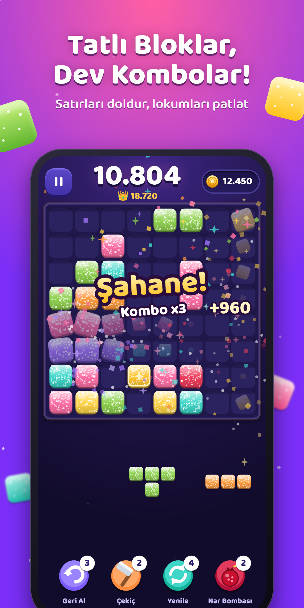
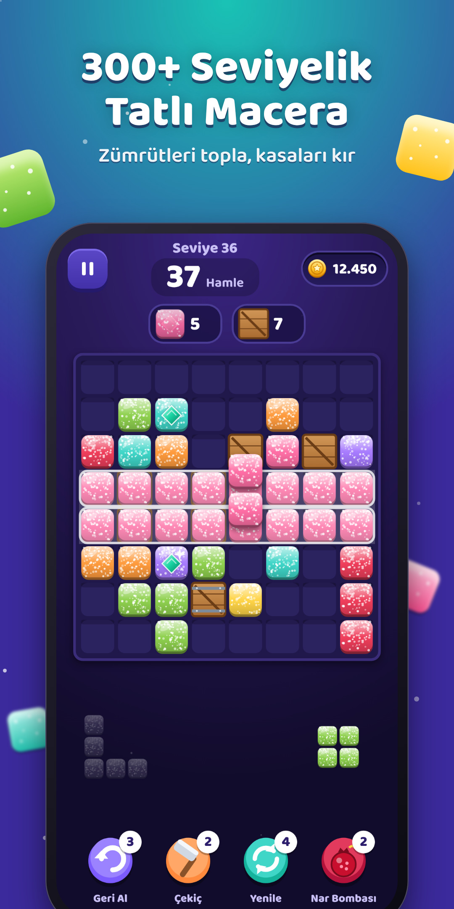
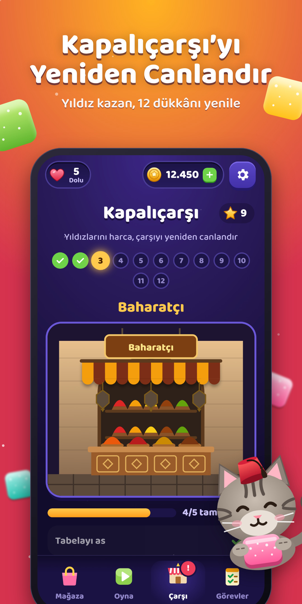
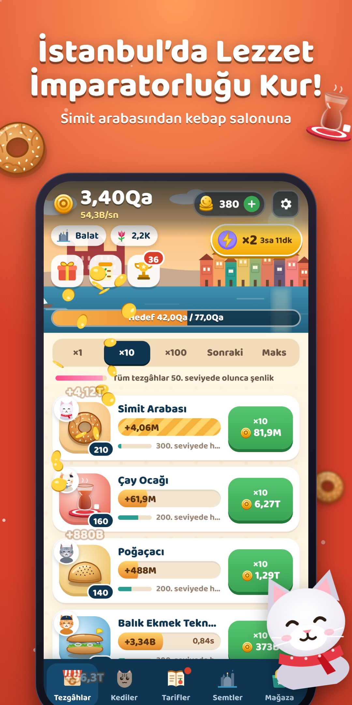
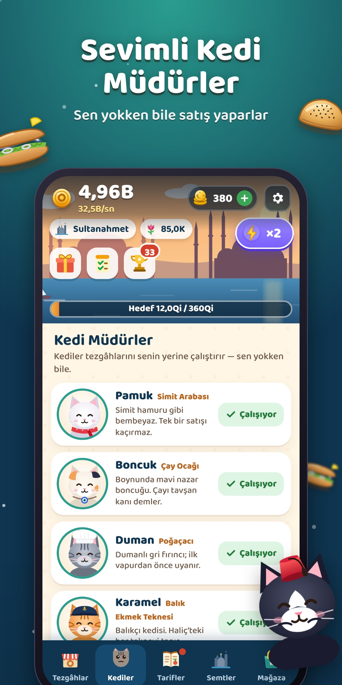
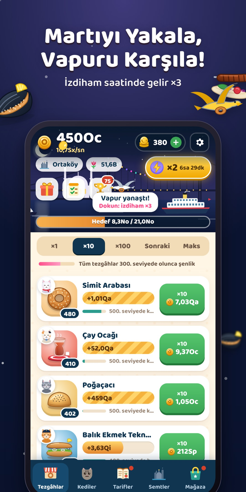

# Tekir Studios 🐾

**İstanbul’dan dünyaya oyunlar ve uygulamalar.**
Çatı marka **Tekir Studios** · Oyun etiketi **Tekir Games** · Uygulama etiketi **Tekir Labs** · Maskot: fesli İstanbul tekiri **Tekir**


## İlk ürün: Lokum Blast: Block Puzzle 🍬

Dünyanın en çok indirilen oyun türü olan blok bulmacayı İstanbul ruhuyla buluşturan bir oyun: lokum kareler, Hicaz makamında kombolar, 300+ seviye ve “Kapalıçarşı’yı canlandır” metası. **iOS ve Android’e yayınlanmaya hazır kod**, mağaza görselleri, metinler ve Türkiye’ye özel fiyatlandırma bu repoda.

| | | |
|---|---|---|
|  |  |  |

## İkinci ürün: Simit Tycoon: Idle Cat Café 🥯🐱

Karaköy iskelesinde tek bir simit arabasıyla başlayıp sevimli kedi müdürlerle Karaköy’den Adalar’a İstanbul’un sokak lezzeti imparatorluğunu kurduğun bir idle tycoon. 10 lezzet, 10 kedi, 8 semt silüeti, martılar ve vapur izdihamı. Ekonomisi bir botla **kalibre edildi**: gündelik oyuncu İstanbul turunu ~5 günde bitiriyor, sonra yeni turlar başlıyor. Sadece ödüllü reklam (zorunlu reklam yok) ve Türkiye’ye özel fiyatlar.

| | | |
|---|---|---|
|  |  |  |

> **Neden Orbita değil?** Portföyde 2. sıradaki Orbita (gezegen birleştirme) için pazar araştırması, aynı dairesel mekaniğe sahip oyunların zaten var olduğunu ve zayıf kaldığını gösterdi. Kedi temalı idle yemek oyunları ise kanıtlanmış bir pazar (Cat Snack Bar, Eatventure) ve İstanbul temalı bir örneği yok. Ayrıntı: [`docs/08`](docs/08-simit-tycoon-oyun-tasarimi.md).

## Repo haritası

| Yol | İçerik |
|---|---|
| [`docs/01-sirket-ve-marka.md`](docs/01-sirket-ve-marka.md) | Şirket adı, marka kimliği, renkler, maskot, tescil ve kuruluş adımları |
| [`docs/02-fikir-portfoyu.md`](docs/02-fikir-portfoyu.md) | 12 oyun ve uygulama fikri, puanlama ve yol haritası |
| [`docs/03-lokum-blast-oyun-tasarimi.md`](docs/03-lokum-blast-oyun-tasarimi.md) | Oyun tasarım belgesi: döngüler, modlar, seviyeler, meta |
| [`docs/04-ekonomi-ve-fiyatlandirma.md`](docs/04-ekonomi-ve-fiyatlandirma.md) | **Bütün oyun içi ürünler, USD ve 🇹🇷 TL fiyatları**, reklam stratejisi, KPI’lar |
| [`docs/05-magaza-metinleri.md`](docs/05-magaza-metinleri.md) | App Store ve Google Play metinleri (TR/EN), anahtar kelimeler, gizlilik formları |
| [`docs/06-yayinlama-rehberi.md`](docs/06-yayinlama-rehberi.md) | Hesap açmaktan mağazaya kadar adım adım yayın |
| [`docs/07-buyume-ve-liveops.md`](docs/07-buyume-ve-liveops.md) | Pazarlama, ASO, etkinlik takvimi, sonraki sürümler |
| [`docs/08-simit-tycoon-oyun-tasarimi.md`](docs/08-simit-tycoon-oyun-tasarimi.md) | Simit Tycoon tasarım belgesi: sistemler, bot ile kalibre edilen tempo, öğretici |
| [`docs/09-simit-tycoon-ekonomi-ve-fiyatlandirma.md`](docs/09-simit-tycoon-ekonomi-ve-fiyatlandirma.md) | **Simit Tycoon ürünleri, USD ve 🇹🇷 TL fiyatları**, altın dengesi, ödüllü reklam stratejisi |
| [`docs/10-simit-tycoon-magaza-metinleri.md`](docs/10-simit-tycoon-magaza-metinleri.md) | Simit Tycoon mağaza metinleri (TR/EN + 4 dil), anahtar kelimeler |
| [`brand/`](brand/) | Logolar ve maskot (SVG + PNG) |
| [`games/lokum-blast/`](games/lokum-blast/) | Oyunun kaynak kodu, iOS ve Android projeleri, testler |
| [`games/lokum-blast/store/output/`](games/lokum-blast/store/output/) | **Mağaza görselleri**: ikon, splash, iPhone/iPad/Android ekran görüntüleri (TR + EN), Play öne çıkan grafiği |
| [`games/lokum-blast/legal/`](games/lokum-blast/legal/) | Gizlilik politikası (KVKK/GDPR) ve kullanım koşulları |
| [`games/simit-tycoon/`](games/simit-tycoon/) | Simit Tycoon kaynak kodu, pacing botu, iOS ve Android projeleri, testler |
| [`games/simit-tycoon/store/output/`](games/simit-tycoon/store/output/) | Simit Tycoon mağaza görselleri (ikon, splash, logo, ekran görüntüleri TR + EN, öne çıkan grafik) |
| [`site/`](site/) | Tekir Studios web sitesi (statik, iki dilli) |

## Hızlı başlangıç

```bash
cd games/lokum-blast     # veya games/simit-tycoon
npm install
npm run dev     # tarayıcıda oyna
npm test        # testler
```
