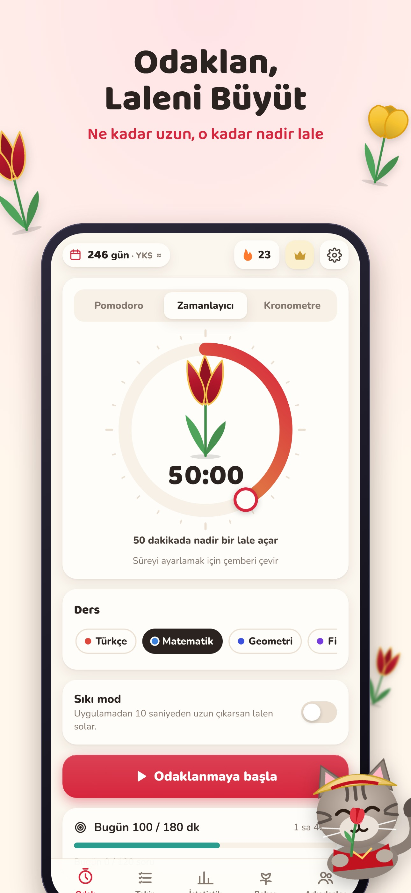

# Lale: YKS Sayaç & Ders Takibi · Lale: Exam Countdown & Focus

*by Tekir Studios / Tekir Labs*

Odaklandıkça İstanbul laleleri açan bir pomodoro bahçesi, Türk sınav sistemini gerçekten bilen bir net takipçisi ve sunucusuz bir sınıf sıralaması.
- **Sınavlar:** YKS (TYT · AYT · YDT), LGS, KPSS, ALES, DGS, YDS, MSÜ ve genel “başka bir sınav” profili.
- **Gizlilik:** Reklam yok, hesap yok, analitik yok. Veri cihazda kalır.
- **İçerik:** 32 lale çeşidi, 7 bahçe, 4 dil (TR, EN, DE, ES), açık/koyu tema.
- **Ekstralar:** Android ana ekran geri sayım widget’ı.
- **Teknoloji:** Vite + TypeScript + Capacitor 8, çerçevesiz (≈66 KB gzip JS).



Karar ve pazar: [`docs/15`](../../docs/15-tekir-labs-ilk-uygulama-karari.md) · Ürün, ekonomi ve TL fiyatları: [`docs/16`](../../docs/16-lale-urun-tasarimi-ve-ekonomi.md) · Mağaza metinleri: [`docs/17`](../../docs/17-lale-magaza-metinleri.md)

## Hızlı başlangıç

```bash
npm install
npm run dev            # http://localhost:5174 (satın alma demo modunda)
npm test               # çekirdek (sınavlar, net, zamanlayıcı, bahçe, seri, arkadaş kodu) + çeviri eşliği
npm run build          # tsc + vite build → dist/
npm run cap:ios        # build + sync + Xcode
npm run cap:android    # build + sync + Android Studio
```

`?debug` parametresi (ve geliştirme modu) test kancasını açar (`window.lale`):
- `store`: kayıt verisi;
- `tab(x)`: sekme değiştirir;
- `skip(sn)`: seansı ileri sarar;
- `closeModals()`, `setLang(l)`.

## Komutlar

| Komut | Ne yapar |
|---|---|
| `node e2e/tour.mjs <url> <klasör> [tr\|en\|de\|es] [light\|dark]` | Onboarding’den ayarlara bütün ekranların görsel turu (23 ekran, sayfa hatası denetimi) |
| `node store/capture.mjs http://localhost:5174` | Mağaza için ham ekranlar (iPhone 6.9″, Android × TR, EN), gerçekçi 6 haftalık veriyle |
| `node --experimental-strip-types store/frames.mjs` | Başlıklı, çerçeveli mağaza görselleri → `store/output/` |
| `node --experimental-strip-types store/icons.mjs` | İkon, adaptive ikon katmanları, splash (açık/koyu), logo, Play öne çıkan grafikleri (TR/EN), web ikonları (+ `assets/`) |
| `npx @capacitor/assets generate` | `assets/` → yerel iOS/Android ikon ve splash setleri |
| `node scripts/native-config.cjs` | `cap add` sonrası yerel ayarlar: izinler (bildirim; AD_ID ve kesin alarm kaldırılır), dikey ekran, bildirim ikonu, sürüm, **geri sayım widget’ı + `LaleWidget` eklentisi**, 4 dilde widget metinleri, iOS dil listesi |
| `node scripts/store-lengths.mjs` | `docs/17` mağaza metinlerinin karakter sınırlarını doğrular |

## Klasörler

| Yol | İçerik |
|---|---|
| `src/core/` | Sınav verisi ve tarihleri (`exams.ts`), net formülleri (`net.ts`), zaman damgalı zamanlayıcı ve sıkı mod (`timer.ts`), lale çeşitleri ve bahçeler (`garden.ts`), seri ve lale soğanı (`streak.ts`), haftalık çalışma kodu (`friends.ts`), istatistik toplamaları (`records.ts`) |
| `src/meta/` | Kayıt ve onarım (`state.ts`), seans bitirme ve kayıt işlemleri (`actions.ts`), ürün kataloğu ve TL fiyatları (`catalog.ts`) |
| `src/ui/` | Kabuk (`app.ts`), onboarding, odak kadranı, seans, kutlama, takip, istatistik, bahçe, arkadaşlar, ayarlar, paywall, çizimler (`art.ts`), grafikler (`charts.ts`) |
| `src/services/` | Satın alma (RevenueCat), yerel bildirimler, widget köprüsü, ses ve ortam sesleri (Web Audio, dosyasız), dosya paylaşımı, değerlendirme, platform |
| `src/i18n/` | TR (anahtar kaynağı), EN, DE, ES |
| `android/` | Capacitor Android projesi + `CountdownWidget.java`, `LaleWidgetPlugin.java` |
| `ios/` | Capacitor iOS projesi |
| `legal/` | Gizlilik politikası (KVKK + GDPR) TR/EN, kullanım koşulları TR/EN |
| `store/output/` | İkon, splash, logo, öne çıkan grafikler, App Store ve Google Play ekran görüntüleri (TR + EN) |

## Yayından önce

1. `src/config.ts`: RevenueCat iOS/Android anahtarları. Yer tutucu anahtarla derlenen native sürümde mağaza **kullanılamaz** olur, bedava premium verilmez.
2. RevenueCat’te `bahcivan` yetkisi tanımlanır:
   - `lale_monthly` ve `lale_yearly` otomatik yenilenir;
   - `lale_lifetime` tüketilmeyen bir satın almadır;
   - `lale_season_yks27` ve `lale_season_lgs27` yenilenmeyen ürünlerdir.
   Fiyatlar `docs/16`’da.
3. Gizlilik ve koşul sayfaları `site/` tarafından `tekirstudios.com/lale/...` adresinde yayımlanır. Şirket bilgilerini doldurun.
4. Sınav tarihleri (`src/core/exams.ts`) ÖSYM/MEB takvimi açıklanınca güncellenir.
5. Sürüm: `package.json` → `node scripts/native-config.cjs` (versionName/versionCode).
