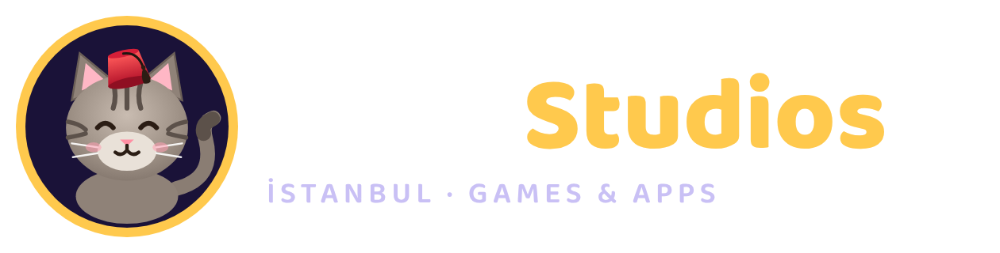

# 01 · Şirket ve Marka: Tekir Studios

## Kısa özet

| | |
|---|---|
| **Çatı marka** | **Tekir Studios** |
| **Oyun etiketi** | **Tekir Games** (casual, hybrid-casual ve bulmaca oyunları) |
| **Uygulama etiketi** | **Tekir Labs** (yapay zekâ destekli yardımcı ve yaşam tarzı uygulamaları) |
| **Maskot** | **Tekir**: kırmızı fesli, yeşil gözlü bir İstanbul tekiri |
| **Slogan (TR)** | *“Merak et, oyna, keyfine bak.”* |
| **Slogan (EN)** | *“Curious games & apps from the cats of Istanbul.”* |
| **İlk ürün** | **Lokum Blast: Block Puzzle**, yani tatlı İstanbul temalı blok bulmaca |



## Neden “Tekir”?

1. **Kısa ve her dilde okunuyor.** “TEH-keer” iki hece. Türkçeye özgü bir harf (ğ, ş, ı) içermiyor, bu yüzden global mağazalarda ve alan adlarında sorun çıkarmıyor.
2. **Hikâyesi var.** İstanbul’un sokak kedileri dünyaca ünlü (2016 yapımı *Kedi* belgeseli bunu kanıtlıyor). Kedi internetin en sevilen karakteri olduğu için maskot doğal olarak viral olabiliyor (sticker, TikTok, merch).
3. **Hem oyuna hem uygulamaya uyuyor.** Kedi meraklı, oyunbaz ve zeki: oyunlarda eğlenceli, uygulamalarda yardımsever bir karakter olarak kullanılabilir.
4. **Çakışma kontrolü.** Ekim 2026’da yaptığım web taramasında “Tekir Games” ya da “Tekir Studios” adında aktif bir mobil oyun şirketi görmedim. Ancak bu hukuki bir garanti değil. Tescilden önce aşağıdaki kontrolleri mutlaka yap.
   - “Lokum Games” adı **elendi**: bu ad Zula’nın geliştiricisi olan, yatırım almış bir İstanbul stüdyosuna ait.

### Marka koruma: yapılacaklar (ilk hafta)

- [ ] **TÜRKPATENT** marka araştırması ve başvurusu. Sınıf 9 (yazılım, mobil uygulama), 41 (eğlence, oyun hizmetleri) ve 42 (yazılım hizmetleri). Marka vekili tutman tavsiye edilir.
- [ ] Global plan için WIPO Madrid başvurusu (AB, ABD, Birleşik Krallık). Gelir başladıktan sonra yapılabilir.
- [ ] Alan adları: `tekirstudios.com` (ana alan), `tekirgames.com`, `tekirlabs.com` ve yedek olarak `tekir.studio`.
- [ ] Sosyal medya kullanıcı adları: `@tekirstudios` (TikTok, Instagram, YouTube, X), `@tekirgames`.
- [ ] Apple Developer ve Google Play hesaplarında görünen geliştirici adı: **Tekir Studios**.

## Şirket kuruluşu (Türkiye) için öneri

> Hukuki ve vergisel konularda kesin karar vermeden önce mutlaka bir **mali müşavirle** görüş.

- **Limited Şirket** önerilir. Apple ve Google’da “kurumsal hesap” açmak, yatırım almak ve marka sahipliği için en temiz yapı bu. Kurumsal Apple hesabı için ücretsiz bir **D-U-N-S numarası** gerekir (başvuru 1–2 hafta sürer).
- Başlangıçta **şahıs şirketi** ile de yayın yapılabilir. Ancak mağazada geliştirici olarak kişisel adın görünür.
- Araştırılmaya değer destekler: **Teknopark/Teknokent** (yazılım geliştirme kazancında vergi avantajları), **KOSGEB** girişimci destekleri, **TÜBİTAK BiGG**. Yurtdışı satış gelirleri hizmet ihracatı kapsamında değerlendirilebilir. Uygunluğu mali müşavirle teyit et.
- Mağaza gelirleri USD olarak gelir ve Apple/Google aylık öder. Bir döviz hesabı aç.

## Görsel kimlik

### Renk paleti

| Ad | HEX | Kullanım |
|---|---|---|
| Gece Moru | `#1A1238` | Ana arka plan, koyu yüzeyler |
| Erik | `#2A1B5C` | Kartlar, ikincil arka plan |
| Saray Altını | `#FFC94D` | Vurgular, para, “Studios” |
| Gül Lokumu | `#FF6FA5` | Oyun etiketi (Tekir Games), CTA |
| Nane | `#3FD6C8` | Uygulama etiketi (Tekir Labs) |
| Fes Kırmızısı | `#D61F38` | Maskot detayları, uyarılar |
| Krem | `#FFF6E8` | Açık zeminler |

### Tipografi

- **Baloo 2** (Google Fonts, OFL lisansı, ticari kullanım ücretsiz). Başlıklarda ExtraBold 800, metinlerde 500–600 ağırlıkla kullan. Türkçe karakterleri (ğ, ş, ı, İ) tam destekliyor.

### Maskot kullanım kuralları

- Tekir her zaman **fesli** çizilir. Fes markanın imzası.
- Üç ruh hâli hazır: `idle` (göz kırpar, kuyruk sallar), `happy` (kazanma ve ödül anları), `sad` (kaybetme ama asla dramatik değil).
- Dosyalar: `brand/mascot/*.svg|png`. Logolar: `brand/logo/*.svg|png`. Yeniden üretmek için: `node --experimental-strip-types brand/render.mjs`.

| Dosya | Kullanım |
|---|---|
| `tekir-studios-dark.*` | Koyu zeminde ana logo |
| `tekir-studios-light.*` | Açık zeminde ana logo |
| `tekir-games.*` / `tekir-labs.*` | Etiket logoları |
| `tekir-avatar.*` | Sosyal medya, geliştirici profili |

## Marka sesi

- **Sıcak, esprili, kısa.** Oyun içi övgüler İstanbul ağzıyla: *“Tatlı!”, “Şahane!”, “Maşallah!”, “Pırıl Pırıl!”*. İngilizcede: *“Sweet!”, “Delicious!”, “Sugar Rush!”*.
- Kültürel motifler (lokum, çini, çarşı, çay, simit, fener) **kartpostal estetiğiyle** kullanılır. Global kitleye egzotik ve sevimli gelir, Türk kullanıcıya nostaljik.
- Asla agresif değil. Satış ekranlarında bile Tekir “hediye” veren taraftır, zorlayan değil.

## Ürün mimarisi

```
Tekir Studios
├── Tekir Games ── Lokum Blast (1. ürün, hazır)
│                 ├── Orbita: Planet Merge (2. ürün, planlandı)
│                 └── Simit Tycoon, Düğüm …  (bkz. 02-fikir-portfoyu.md)
└── Tekir Labs ─── Lokma: AI Kalori (abonelik)
                  ├── Telve: AI Kahve Falı (abonelik)
                  └── Nefes, Masal AI …
```

Bütün ürünler **aynı maskotu ve aynı paleti** paylaşır. Böylece bir oyunun oyuncusu diğer oyunu çapraz tanıtımla (cross-promo) kolayca tanır. Bu bedava kullanıcı kazanımı demek.
