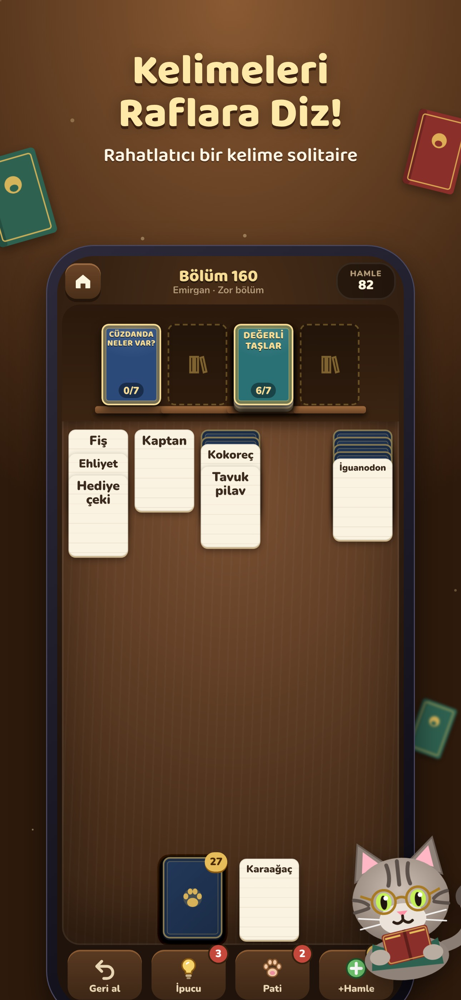

# Kitap Kedisi: Kelime Solitaire · Bookcat: Word Solitaire

*by Tekir Studios / Tekir Games*

Kelime çağrışımlı solitaire: raf etiketini rafa koy, o kategoriye ait kelimeleri bul ve diz, Tekir’in İstanbul’daki sahafını toparla. **Her bölüm çözülebilir** (bölümler bir çözücü botla üretilip kalibre edilir), bölüm ortasında reklam yok, can sistemi yok. 129 kategori × 4 dil (TR, EN, DE, ES), 300 ayarlı bölüm ve sonrası anında üretim, Günün Rafı, görevler, nadir kitap koleksiyonu. **Vite + TypeScript + Capacitor 8**, çerçevesiz (≈80 KB gzip).



Tasarım: [`docs/12`](../../docs/12-kitap-kedisi-oyun-tasarimi.md) · Ekonomi ve TL fiyatları: [`docs/13`](../../docs/13-kitap-kedisi-ekonomi-ve-fiyatlandirma.md) · Mağaza metinleri: [`docs/14`](../../docs/14-kitap-kedisi-magaza-metinleri.md)

## Hızlı başlangıç

```bash
npm install
npm run dev            # http://localhost:5173 (reklam ve satın alma demo modunda)
npm test               # motor (kurallar, çözücü, seviyeler) + içerik kalitesi testleri
npm run build          # tsc + vite build → dist/
npm run cap:ios        # build + sync + Xcode
npm run cap:android    # build + sync + Android Studio
```

URL parametreleri: `?level=45` bölümü doğrudan açar, `?daily` Günün Rafı’nı açar, `?e2e` test kancasını (`window.__bookcat`) açar.

## Komutlar

| Komut | Ne yapar |
|---|---|
| `npm run calibrate` | 300 bölümü çözücüyle yeniden üretir → `src/core/level-tuning.json` + `scripts/calibration.txt` (~1 dk) |
| `FROM=1 TO=3 SCRIPT=scripts/patch-levels.test.ts npx vitest run --config scripts/vitest.scripts.ts` | Yalnızca seçilen bölümleri yeniden kalibre eder |
| `node e2e/play.mjs http://localhost:5173/` | 29 kontrollü uçtan uca oynanış: öğretici, dokun-oynat, geri al, ipucu, pati, kazanma, kaybetme, altınla ve videoyla +10 hamle, tekrar dene, kaldığın yerden devam, Günün Rafı serisi, mağaza, ara reklam sıklığı, dil, kayıt |
| `node e2e/tour.mjs <url> <klasör> [tr\|en\|de\|es]` | Bütün ekranların görsel turu |
| `node store/capture.mjs http://localhost:5173` | Mağaza için ham ekranlar (iPhone 6.9″, iPad 13″, Android × TR, EN) |
| `node --experimental-strip-types store/frames.mjs` | Başlıklı, çerçeveli mağaza görselleri → `store/output/` |
| `node --experimental-strip-types store/icons.mjs` | İkon, adaptive ikon katmanları, splash, logo, Play öne çıkan grafikleri (TR/EN), web ikonları (+ `assets/`) |
| `npx @capacitor/assets generate` | `assets/` → yerel iOS/Android ikon ve splash setleri |
| `node scripts/native-config.cjs` | `cap add` sonrası yerel ayarlar: AdMob test kimliği, izinler, dikey ekran, bildirim ikonu, sürüm, iOS izin metinleri, TR uygulama adı |
| `node scripts/ios-localize.cjs` | iOS izin metinlerini ve görünen adı (4 dil) Xcode projesine kaydeder |

## Klasörler

| Yol | İçerik |
|---|---|
| `src/core/` | Kurallar (`rules.ts`), dağıtım (`deal.ts`), çözücü ve planlayıcı bot (`solver.ts`), bölüm üretimi ve kalibrasyon (`levels.ts`) |
| `src/content/` | 129 kategori: `core.ts`, `everyday.ts` (kademe 1–2), `world.ts` (3), `expert.ts` (4–5); seçim ve çakışma kuralları `index.ts` |
| `src/game/session.ts` | Bir bölümün oturumu: hamle, geri al, ipucu, pati, ek hamle, kayıt |
| `src/meta/` | Kayıt, ekonomi, ürün kataloğu (TL fiyatları), semtler, günlük sistemler, ilerleme |
| `src/ui/` | Ana ekran, oyun ekranı, kart masası, diyaloglar, çizimler |
| `src/services/` | Reklam (AdMob), satın alma (RevenueCat), ses, bildirim, değerlendirme, platform |
| `src/i18n/` | TR (anahtar kaynağı), EN, DE, ES |
| `legal/` | Gizlilik politikası (KVKK + GDPR) TR/EN, kullanım koşulları |
| `store/output/` | Mağaza görselleri |

## Yayın öncesi değiştirilecekler

1. `src/config.ts`: AdMob ara reklam ve ödüllü reklam birimi kimlikleri, `testing: false`, RevenueCat anahtarları
2. `ios/App/App/Info.plist` → `GADApplicationIdentifier`
3. `android/app/src/main/AndroidManifest.xml` → `com.google.android.gms.ads.APPLICATION_ID`
4. App Store Connect ve Play Console’da `src/meta/catalog.ts` içindeki 10 ürünü aynı kimliklerle oluştur, Türkiye fiyatlarını elle gir (bkz. `docs/13`)
5. RevenueCat’te `no_ads` yetkisini (entitlement) tanımla
6. `legal/` metinlerine şirket unvanı ve adresini yaz, hukukçuya kontrol ettir
7. Web sitesinde `app-ads.txt` yayıncı kimliği
