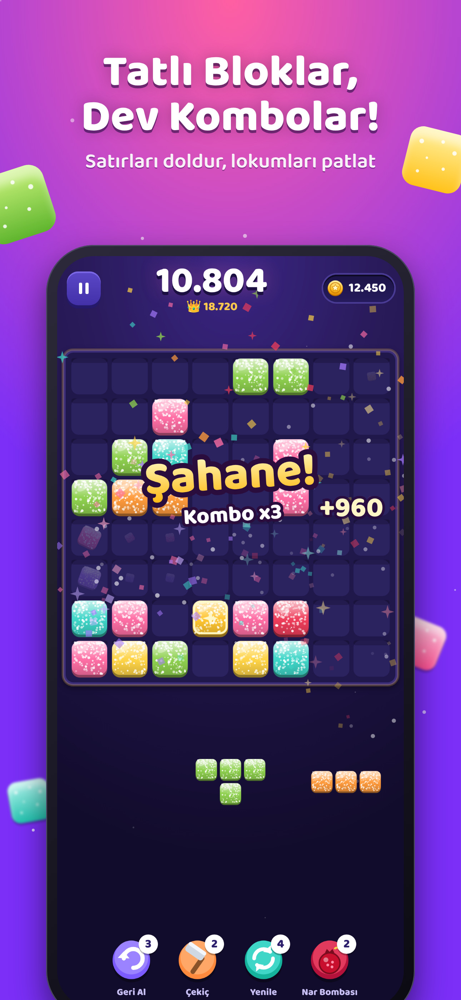

# Lokum Blast: Block Puzzle

*by Tekir Studios / Tekir Games*

İstanbul temalı blok bulmaca: 8×8 tahta, lokum kareler, kombolar, 300+ seviyelik Yolculuk, Kapalıçarşı restorasyonu, günlük sistemler, 6 tema, 6 dil. **Vite + TypeScript + Capacitor 8**.



## Hızlı başlangıç

```bash
npm install
npm run dev            # http://localhost:5173 (reklam ve satın alma demo modunda)
npm test               # birim testleri (oyun mantığı, skor, seviyeler, çeviriler)
npm run build          # tsc + vite build → dist/
npm run cap:ios        # build + sync + Xcode
npm run cap:android    # build + sync + Android Studio
```

## Komutlar

| Komut | Ne yapar |
|---|---|
| `npm run calibrate` | 300 seviyeyi botla simüle eder ve hamle bütçelerini `src/core/level-tuning.json` dosyasına yazar (~3 dk) |
| `FROM=1 TO=60 npm run balance` | Seçilen seviyeler için kazanma oranı raporu üretir |
| `node e2e/play.mjs http://localhost:4173/ <klasör>` | Uçtan uca oynanış testi + ekran görüntüleri (önce `npx vite preview --port 4173`) |
| `node store/capture.mjs` | Mağaza için ham oyun ekranlarını yakalar (iPhone, iPad, Android × TR, EN) |
| `node --experimental-strip-types store/frames.mjs` | Pazarlama çerçeveli ekran görüntülerini üretir |
| `node --experimental-strip-types store/icons.mjs` | İkon, adaptive ikon, splash ve Play öne çıkan grafiğini üretir |
| `node scripts/ios-localize.cjs` | iOS izin metinlerini (6 dil) Xcode projesine kaydeder |

## Yayın öncesi değiştirilecekler

1. `src/config.ts`: AdMob reklam birimi kimlikleri, `testing: false`, RevenueCat anahtarları, destek e-postası, gizlilik/koşullar URL’leri
2. `ios/App/App/Info.plist` → `GADApplicationIdentifier`
3. `android/app/src/main/AndroidManifest.xml` → `com.google.android.gms.ads.APPLICATION_ID`
4. `legal/` metinlerini doldurup sitende yayınla

Ayrıntılı adımlar: [`../../docs/06-yayinlama-rehberi.md`](../../docs/06-yayinlama-rehberi.md)

## Mimari

| Klasör | İçerik |
|---|---|
| `src/core/` | Saf oyun mantığı: `board`, `pieces`, `dealer` (adil parça dağıtıcı), `scoring`, `levels` (prosedürel + kalibre), `session`, `bot` |
| `src/game/` | Canvas sahnesi, sprite önbelleği, efektler, 6 tema |
| `src/meta/` | Kayıt sistemi, ekonomi, IAP kataloğu (USD + TRY), günlük sistemler, çarşı |
| `src/services/` | Sentez ses motoru (Hicaz), AdMob, RevenueCat, yerel bildirim, haptik |
| `src/ui/` | Ana ekran, oyun HUD’u, mağaza, çarşı, görevler, diyaloglar, SVG çizimler |
| `src/i18n/` | TR, EN, DE, ES, FR, PT |

Ana paket ≈ 57 KB gzip. Çerçeve kütüphanesi yok.
