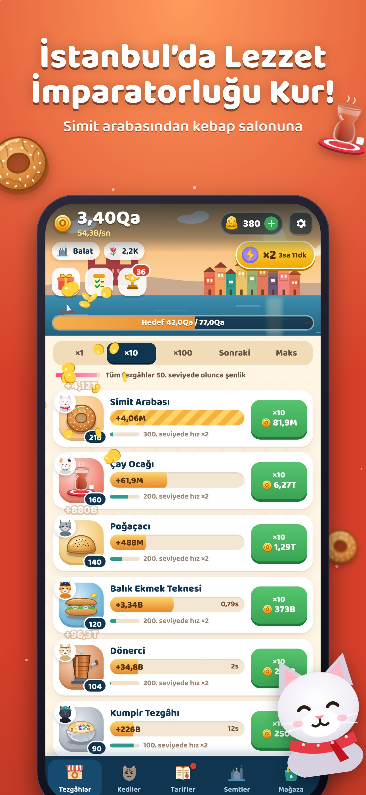

# Simit Tycoon: Idle Cat Café

*by Tekir Studios / Tekir Games*

İstanbul temalı idle tycoon: Karaköy iskelesinde tek bir simit arabasıyla başla, 10 sokak lezzeti ve 10 kedi müdürle Karaköy’den Adalar’a 8 semtte lezzet imparatorluğu kur. Martı yakala, vapuru karşıla, sen yokken de kazan. **Vite + TypeScript + Capacitor 8**, 6 dil, çerçevesiz (≈68 KB gzip).



## Hızlı başlangıç

```bash
npm install
npm run dev            # http://localhost:5173 (reklam ve satın alma demo modunda)
npm test               # 41 birim testi: ekonomi, oyun kontrolcüsü, günlük sistemler, 6 dilin eksiksizliği
npm run build          # tsc + vite build → dist/
npm run cap:ios        # build + sync + Xcode
npm run cap:android    # build + sync + Android Studio
```

## Komutlar

| Komut | Ne yapar |
|---|---|
| `npm run simulate` | Pacing botu: ilk oturum + 30 gün × 5 oyuncu profili → `scripts/pacing-report.txt` (~2 dk) |
| `npm run calibrate` | Semt hedeflerini gündelik oyuncu profiline göre yeniden hesaplar → `src/core/goals.json` |
| `TUNE='{"lalePower":0.45}' npm run simulate` | Oyunu değiştirmeden alternatif denge dener (`TUNING` alanları) |
| `node e2e/play.mjs http://localhost:5173/` | 25 kontrollü uçtan uca oynanış (dokunma, satın alma, kedi, reklam, martı, vapur, taşınma, çevrimdışı kazanç, mağaza, dil, kayıt) |
| `node e2e/tour.mjs <url> <klasör> [dil]` | Bütün ekranların görsel turu (ekran görüntüsü) |
| `node store/capture.mjs http://localhost:4174/` | Mağaza için ham ekranlar (iPhone 6.9″, iPad 13″, Android × TR, EN). Önce `npm run build && npx vite preview --port 4174` |
| `node --experimental-strip-types store/frames.mjs` | Başlıklı, çerçeveli mağaza görselleri → `store/output/` |
| `node --experimental-strip-types store/icons.mjs` | İkon, adaptive ikon katmanları, splash, logo, Play öne çıkan grafiği (+ `assets/`) |
| `npx @capacitor/assets generate` | `assets/` → yerel iOS/Android ikon ve splash setleri |
| `node scripts/native-config.cjs` | `cap add` sonrası yerel ayarlar: AdMob test ID, izinler, dikey ekran, bildirim ikonu, sürüm, iOS izin metinleri |
| `node scripts/ios-localize.cjs` | iOS izin metinlerini (6 dil) Xcode projesine kaydeder |

## Yayın öncesi değiştirilecekler

1. `src/config.ts`: AdMob ödüllü reklam birimi kimlikleri, `testing: false`, RevenueCat anahtarları, destek e-postası, gizlilik/koşullar URL’leri
2. `ios/App/App/Info.plist` → `GADApplicationIdentifier`
3. `android/app/src/main/AndroidManifest.xml` → `com.google.android.gms.ads.APPLICATION_ID`
4. App Store Connect / Play Console’da ürünleri oluştur (`src/meta/catalog.ts`, fiyatlar: [`../../docs/09-simit-tycoon-ekonomi-ve-fiyatlandirma.md`](../../docs/09-simit-tycoon-ekonomi-ve-fiyatlandirma.md))
5. `legal/` metinlerini doldurup sitende yayınla

Genel yayın adımları: [`../../docs/06-yayinlama-rehberi.md`](../../docs/06-yayinlama-rehberi.md) · Mağaza metinleri: [`../../docs/10-simit-tycoon-magaza-metinleri.md`](../../docs/10-simit-tycoon-magaza-metinleri.md) · Tasarım: [`../../docs/08-simit-tycoon-oyun-tasarimi.md`](../../docs/08-simit-tycoon-oyun-tasarimi.md)

## Mimari

| Klasör | İçerik |
|---|---|
| `src/core/` | Saf ekonomi: tezgâhlar, kilometre taşları, şenlikler, tarifler, prestij (lale + rozet), semt hedefleri, büyük sayı biçimlendirme; semt tanımları |
| `src/meta/` | Oyun kontrolcüsü (olaylar, çarpanlar, çevrimdışı kazanç, zaman atlama), kayıt + onarım, katalog (USD + TRY), giriş takvimi, görevler, başarımlar |
| `src/services/` | Sentez ses (Nihavend kafe müziği, miyav, vapur düdüğü), AdMob (sadece ödüllü), RevenueCat, yerel bildirim, değerlendirme isteği, haptik |
| `src/ui/` | HUD ve semt silüeti, 5 sekme, diyaloglar, öğretici (Tekir + pati), efektler; `art.ts` (yemekler, kediler), `skyline.ts` (8 İstanbul silüeti), `logo.ts` |
| `src/i18n/` | TR, EN, DE, ES, FR, PT (semt adları Türkçe ek uyumuyla: Balat’ta, Galata’ya) |
| `scripts/` | Pacing botu, kalibrasyon, simülasyon, yerel yapılandırma |
| `tests/`, `e2e/` | Birim testleri, uçtan uca oynanış, görsel tur |
| `store/` | Mağaza görseli betikleri ve çıktıları |
